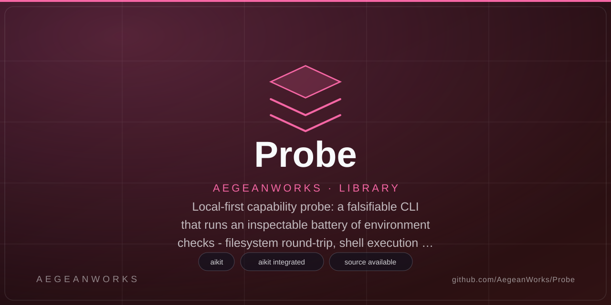

# Probe

<!-- aegean:media:start -->
<p align="center"></p>
<p align="center"><a href="LICENSE"></a> <a href="https://github.com/AegeanWorks/AIKit"></a></p>
<!-- aegean:media:end -->


Local-first capability probe: a falsifiable CLI that runs an inspectable battery of environment checks - filesystem round-trip, shell execution, git state, imports and timing - and writes a verifiable JSON report of what was actually measured.

> **Archived**: Archived after delivery: the project was published as AegeanWorks/Probe and verified (reforge run-1, gates 5/5, publish done). (archived 2026-11-19). This project is read-only; its GitHub repository is archived.

## ⚡ 30-Second Cold-Start Quick Reference

- **Runtime Prerequisites**: Python 3.10+ (standard library only); git on PATH (the `git` check needs it)
- **Canonical Regression Shield Gate**:
  ```bash
  python -m unittest discover
  ```

### 🛠️ AIKit Commands (run from the AIKit folder)
| Role | Command |
|---|---|
| Status, task and gates | `python aikit.py status probe` |
| Phase 4: every gate | `python aikit.py check probe` |
| Repair memory and map, then check | `python aikit.py fix probe` |
| Resume an interrupted task | `python aikit.py resume probe` |

## 📦 What's Inside

```text
probe/                        <- root
├── .gitattributes            <- LF line endings on every platform
├── .gitignore                <- transient state excluded, including reports/
├── LICENSE                   <- Aegean License 1.1 (AL-1.1): free personal use
├── COMMERCIAL.md             <- Commercial licensing terms
├── LICENSES/                 <- REUSE license texts
├── REUSE.toml                <- Machine-readable SPDX metadata
├── README.md
├── assets/
├── probe.py                  <- the capability-probe CLI (`python probe.py run [--deep]`)
├── demo.py                   <- AI-compat scripted drive: WORLD-DELTA lines (ADR-315)
├── inventory.py              <- AI-compat inventory: kind|name|locator lines (ADR-315)
├── tests/
│   ├── __init__.py           <- the tests package marker for discovery
│   ├── test_probe.py         <- unit tests for the pure functions and checks
│   └── test_probe_cli.py     <- integ tests: the CLI runs the battery end-to-end
└── .aikit/                   <- this project's memory: record, ledger, decisions
```

## 🧪 Running the Probe

```bash
python probe.py checks        # list the check ids and what each measures
python probe.py run           # fs, shell, git, imports; exit 0 when all pass
python probe.py run --deep    # adds timing and web (the web check fetches the profile page by default)
```

Every check returns a `CheckResult` whose evidence names what was observed: a report claims a check passed only when the observation supports it. Reports land in `reports/probe-report-<UTC stamp>.json`; `--out FILE` overrides the path, `--json` prints the report instead of the table.

<!-- aegean:brand-assets:start -->
## 🎨 Brand Assets

> **AI-Generated Brand Artwork.** The banner and logo are **AI-generated brand assets**. They are illustrative and may not literally depict every feature or the full project scope.
<!-- aegean:brand-assets:end -->

## 📜 License

Free for personal use under the Aegean License 1.1 (AL-1.1); see [LICENSE](LICENSE). Any commercial use needs the Aegean Commercial License 1.0 (ACL-1.0); see [COMMERCIAL.md](COMMERCIAL.md).
